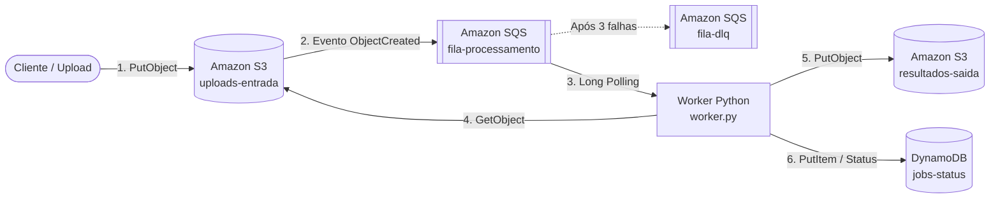

# Arquitetura Orientada a Eventos com AWS Emulator

Este guia documenta como executar localmente uma arquitetura assíncrona orientada a eventos utilizando o **AWS Emulator** em Docker, integrando **Amazon S3**, **Amazon SQS** (com **Dead Letter Queue**), **Amazon DynamoDB** e um **Worker Python**.

## 1. Desenho da Arquitetura

### Diagrama de Fluxo (Mermaid)



### Diagrama ASCII

```text
  [1. Cliente / Upload] 
           │ (PutObject)
           ▼
   ┌───────────────┐
   │   Amazon S3   │  (Bucket: uploads-entrada)
   └───────┬───────┘
           │ (S3 Event Notification: s3:ObjectCreated:*)
           ▼
   ┌───────────────┐       (Falha após 3 tentativas)      ┌───────────────────┐
   │  Amazon SQS   │ ───────────────────────────────────► │  Amazon SQS (DLQ) │
   └───────┬───────┘                                      └───────────────────┘
           │ (Long Polling: ReceiveMessage)
           ▼
   ┌───────────────┐
   │    Worker     │  (worker.py)
   └───┬───────┬───┘
       │       │
       │       └──────────────────────────────────────────┐
       ▼ (PutObject: arquivo processado)                  ▼ (PutItem: metadados/status)
┌───────────────┐                                  ┌───────────────┐
│   Amazon S3   │ (Bucket: resultados-saida)       │   DynamoDB    │ (Tabela: jobs-status)
└───────────────┘                                  └───────────────┘
```

## 2. Como Executar Localmente

### Pré-requisitos

* **Docker** instalado e em execução.
* **AWS CLI v2** instalado na máquina host.
* **Python 3** com suporte a ambientes virtuais (`python3-venv` e `python3-pip`).

### Passo 1: Construir e Subir o AWS Emulator (Terminal 1)

*(Nota: Em sessões Live USB/CD como Linux Mint Live, configure `"storage-driver": "vfs"` em `/etc/docker/daemon.json` antes do build).*

```bash
# 1. Construir a imagem Docker
sudo docker build -t aws-emulator .

# 2. Criar diretório compartilhado com permissões do usuário local
mkdir -p ~/.aws/emulator

# 3. Iniciar o contêiner na porta 9297
PORT=9297
sudo docker run --rm --memory=2g --memory-swap=2g \
  --user "$(id -u):$(id -g)" \
  -p 127.0.0.1:$PORT:$PORT \
  -e HOME="$HOME" \
  -v "$HOME/.aws/emulator:$HOME/.aws/emulator" \
  aws-emulator -p $PORT
```

> Mantenha o **Terminal 1** aberto. Todos os recursos ficam em memória RAM e são apagados ao parar o contêiner (`Ctrl+C`).

### Passo 2: Provisionar a Infraestrutura AWS Local (Terminal 2)

Abra um **segundo terminal**, aponte o AWS CLI para as credenciais geradas pelo emulador e crie os recursos:

```bash
# 1. Exportar credenciais e configuração geradas pelo emulador
export AWS_CONFIG_FILE=~/.aws/emulator/9297/config
export AWS_SHARED_CREDENTIALS_FILE=~/.aws/emulator/9297/emulator_credentials

# 2. Criar buckets S3 (entrada e saída)
aws s3 mb s3://uploads-entrada
aws s3 mb s3://resultados-saida

# 3. Criar tabela DynamoDB para rastreamento de status
aws dynamodb create-table \
  --table-name jobs-status \
  --attribute-definitions AttributeName=arquivo_id,AttributeType=S \
  --key-schema AttributeName=arquivo_id,KeyType=HASH \
  --billing-mode PAY_PER_REQUEST

# 4. Criar Dead Letter Queue (DLQ) e Fila Principal
DLQ_URL=$(aws sqs create-queue --queue-name fila-dlq --query 'QueueUrl' --output text)
DLQ_ARN=$(aws sqs get-queue-attributes --queue-url "$DLQ_URL" --attribute-names QueueArn --query 'Attributes.QueueArn' --output text)

QUEUE_URL=$(aws sqs create-queue \
  --queue-name fila-processamento \
  --attributes "{\"RedrivePolicy\":\"{\\\"deadLetterTargetArn\\\":\\\"$DLQ_ARN\\\",\\\"maxReceiveCount\\\":\\\"3\\\"}\"}" \
  --query 'QueueUrl' --output text)
QUEUE_ARN=$(aws sqs get-queue-attributes --queue-url "$QUEUE_URL" --attribute-names QueueArn --query 'Attributes.QueueArn' --output text)

# 5. Conectar evento de criação de objeto do S3 à fila SQS
aws sqs set-queue-attributes \
  --queue-url "$QUEUE_URL" \
  --attributes "{\"Policy\":\"{\\\"Version\\\":\\\"2012-10-17\\\",\\\"Statement\\\":[{\\\"Effect\\\":\\\"Allow\\\",\\\"Principal\\\":{\\\"Service\\\":\\\"s3.amazonaws.com\\\"},\\\"Action\\\":\\\"SQS:SendMessage\\\",\\\"Resource\\\":\\\"$QUEUE_ARN\\\"}]}\"}"

aws s3api put-bucket-notification-configuration \
  --bucket uploads-entrada \
  --notification-configuration "{\"QueueConfigurations\":[{\"QueueArn\":\"$QUEUE_ARN\",\"Events\":[\"s3:ObjectCreated:*\"]}]}"
```

### Passo 3: Configurar o Ambiente Virtual (`.venv`) e Iniciar o Worker (Terminal 2)

No mesmo terminal onde as variáveis `AWS_*` estão configuradas, crie o ambiente virtual Python, instale o `boto3` e inicie o consumidor:

```bash
# 1. Instalar dependências de ambiente virtual (caso não estejam instaladas no sistema)
sudo apt-get update && sudo apt-get install -y python3-venv python3-pip

# 2. Criar e ativar o ambiente virtual (.venv)
python3 -m venv .venv
source .venv/bin/activate

# 3. Instalar o SDK boto3 dentro do (.venv)
pip install boto3

# 4. Executar o Worker
python3 worker.py
```

*(Nota: Sempre que abrir um novo terminal para rodar o Worker posteriormente, ative o ambiente antes com `source .venv/bin/activate`).*

**Saída esperada:**

```text
[*] Worker iniciado. Escutando fila: https://127.0.0.1:9297/.../fila-processamento
```

## 3. Cenários de Validação

Abra um **terceiro terminal** para atuar como produtor de eventos e inspetor dos recursos. Primeiro, carregue as credenciais do emulador:

```bash
export AWS_CONFIG_FILE=~/.aws/emulator/9297/config
export AWS_SHARED_CREDENTIALS_FILE=~/.aws/emulator/9297/emulator_credentials
```

### Cenário 1: Fluxo Completo (Upload → Evento S3 → SQS → Worker → DynamoDB/S3)

Valida o processamento assíncrono de ponta a ponta em condições normais.

1. **Disparar evento fazendo upload de um arquivo:**

   ```bash
   echo "relatorio financeiro consolidado 2026" > relatorio.txt
   aws s3 cp relatorio.txt s3://uploads-entrada/relatorio.txt
   ```

2. **Validar no Terminal do Worker:**
   Observe os logs confirmando o recebimento e a conclusão:

   ```text
   [->] Novo evento recebido: s3://uploads-entrada/relatorio.txt
   [OK] Concluído: s3://resultados-saida/processado-relatorio.txt
   ```

3. **Validar o artefato gerado no Bucket de Saída:**

   ```bash
   aws s3 cp s3://resultados-saida/processado-relatorio.txt -
   ```

4. **Validar o estado persistido no DynamoDB:**

   ```bash
   aws dynamodb scan --table-name jobs-status
   ```

   *(Confirme que o item `relatorio.txt` possui `"status": {"S": "CONCLUIDO"}`).*

### Cenário 2: Desacoplamento e Retenção em Fila (Worker Offline)

Valida que os eventos não são perdidos quando o serviço consumidor está fora do ar ou em manutenção.

1. **Interromper o Worker:** No Terminal 2, pressione `Ctrl+C` para parar o `worker.py`.

2. **Enviar múltiplos arquivos enquanto o consumidor está offline:**

   ```bash
   echo "pedido 001" > pedido1.txt
   echo "pedido 002" > pedido2.txt
   aws s3 cp pedido1.txt s3://uploads-entrada/pedido1.txt
   aws s3 cp pedido2.txt s3://uploads-entrada/pedido2.txt
   ```

3. **Verificar o acúmulo de mensagens na fila SQS:**

   ```bash
   QUEUE_URL=$(aws sqs get-queue-url --queue-name fila-processamento --query 'QueueUrl' --output text)
   aws sqs get-queue-attributes --queue-url "$QUEUE_URL" --attribute-names ApproximateNumberOfMessages
   ```

   *(O valor retornado será `"ApproximateNumberOfMessages": "2"`).*

4. **Religar o Worker (com `.venv` ativo) e confirmar o dreno da fila:**
   No Terminal 2, execute:
   ```bash
   source .venv/bin/activate
   python3 worker.py
   ```
   Ambos os arquivos serão processados imediatamente em sequência.

### Cenário 3: Resiliência e Isolamento de Falhas (Dead Letter Queue)

Valida o comportamento do sistema quando um arquivo inválido provoca erro no processamento, garantindo que mensagens defeituosas não travem a fila principal nem derrubem o processo do Worker.

1. **Enviar um arquivo binário inválido (que causará erro de decodificação UTF-8 no Worker):**

   ```bash
   dd if=/dev/urandom of=arquivo-corrompido.txt bs=64 count=1
   aws s3 cp arquivo-corrompido.txt s3://uploads-entrada/arquivo-corrompido.txt
   ```

2. **Acompanhar as retentativas no Terminal 2:**
   O Worker capturará a exceção `UnicodeDecodeError`, registrará o status `ERRO` no DynamoDB e manterá o processo ativo sem chamar `delete_message`. Após o *Visibility Timeout* da fila expirar 3 vezes (`maxReceiveCount: 3`), o SQS moverá a mensagem automaticamente para a DLQ.

3. **Verificar a mensagem isolada na DLQ:**

   ```bash
   DLQ_URL=$(aws sqs get-queue-url --queue-name fila-dlq --query 'QueueUrl' --output text)
   aws sqs get-queue-attributes --queue-url "$DLQ_URL" --attribute-names ApproximateNumberOfMessages
   ```

   *(O contador da `fila-dlq` passará para `"1"`, enquanto a `fila-processamento` voltará a `"0"`).*

## 4. Referências

* [Documentação Oficial: AWS Emulator User Guide](https://docs.aws.amazon.com/emulator/latest/userguide/what-is-emulator.html)
* [Guia Oficial: Getting Started with Docker (AWS Emulator)](https://docs.aws.amazon.com/emulator/latest/userguide/getting-started-docker.html)
* [Amazon S3 Event Notifications](https://docs.aws.amazon.com/AmazonS3/latest/userguide/EventNotifications.html)
* [Amazon SQS Dead-Letter Queues](https://docs.aws.amazon.com/AWSSimpleQueueService/latest/SQSDeveloperGuide/sqs-dead-letter-queues.html)